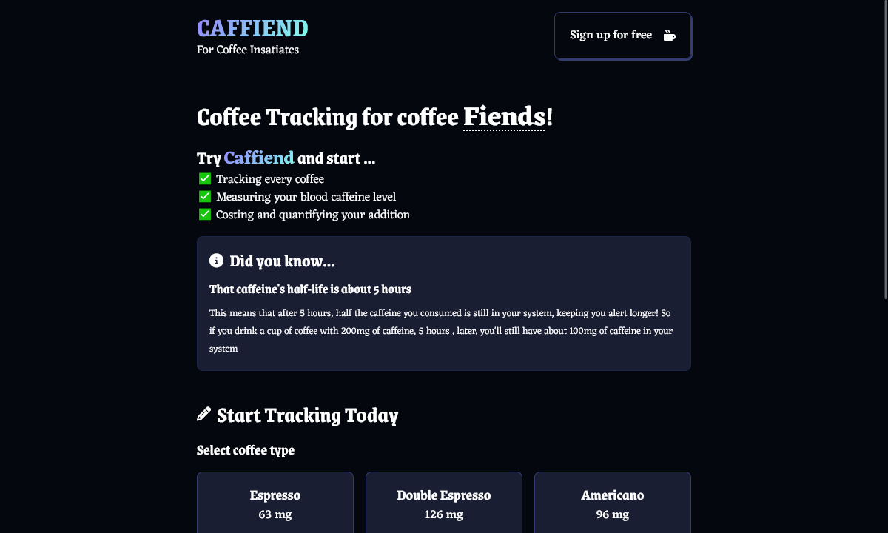
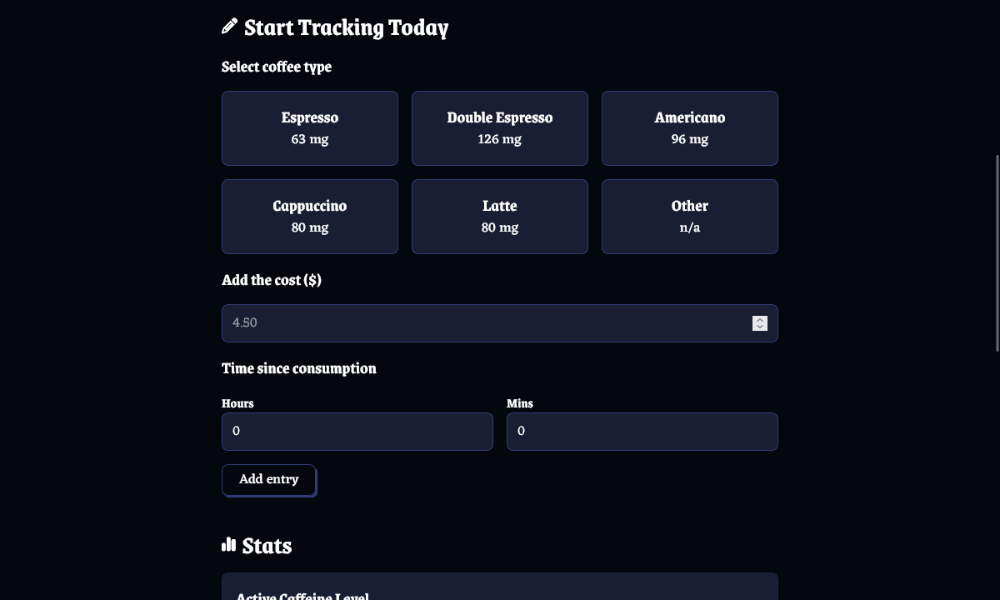
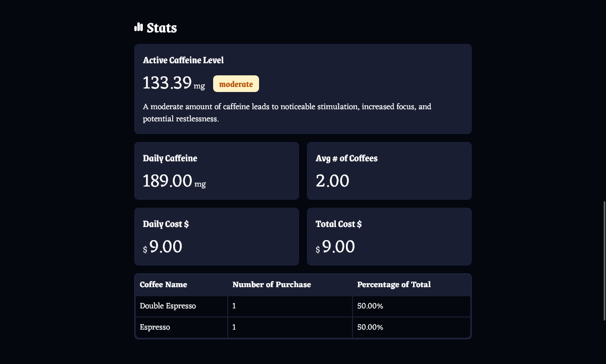
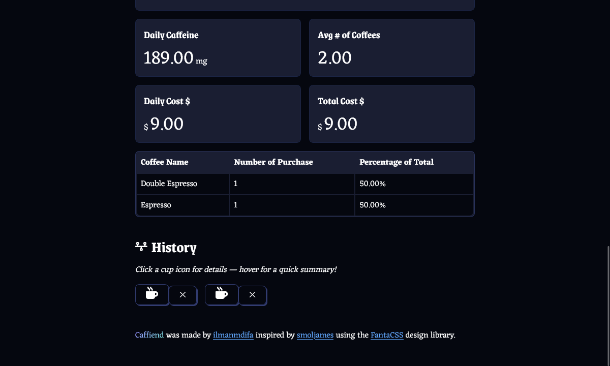
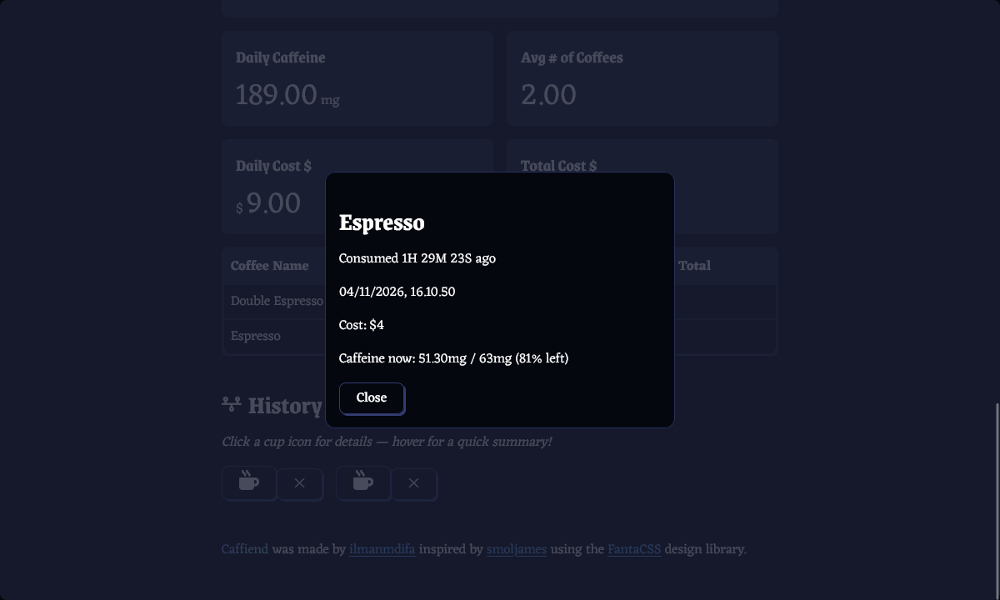
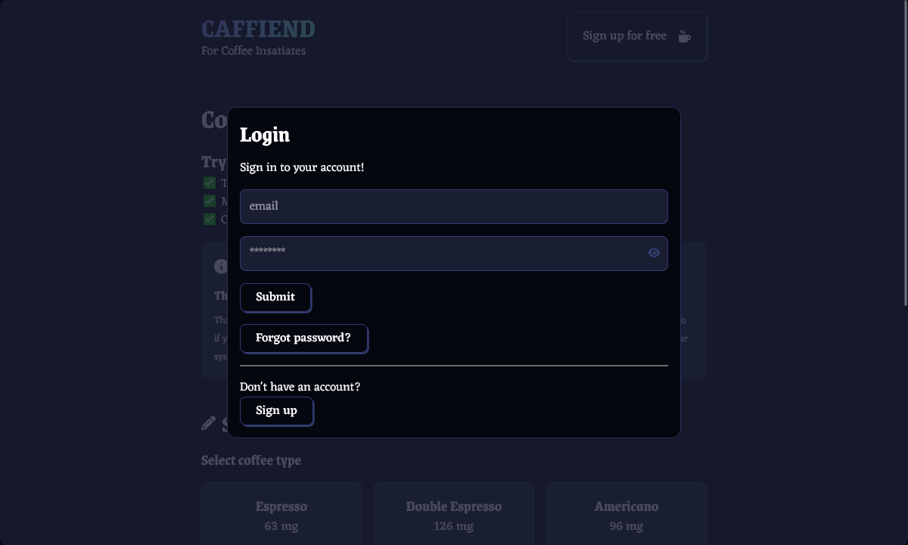

# Caffiend ☕
Track your coffee consumption, measure your caffeine levels, and manage your coffee habits with ease.

## Demo
Check out the live demo of Caffiend: [Caffiend Demo](https://caffiend-kopi-tracker.vercel.app/)

## Screenshots









## Features
- **Coffee Tracking**: Log your coffee consumption with details like type, cost, and time.
- **Caffeine Level Monitoring**: Calculate your current caffeine levels based on half-life.
- **Realtime Sync**: Entries stay in sync across tabs and devices via a Firestore `onSnapshot` listener.
- **Entry Details**: Click a cup icon in History for the exact time, cost, and remaining caffeine of each entry.
- **Statistics**: View daily caffeine intake, average coffee consumption, and total cost.
- **History**: Review your coffee consumption history, delete entries with a confirmation dialog.
- **Authentication**: Sign up, log in, forgot password (with show/hide password and confirm password on signup), and manage your data securely with Firebase.

## Installation
1. Clone the repository:
   ```bash
   git clone https://github.com/Ilmanmdifa/caffiend.git
   cd caffiend
   ```
2. Install dependencies:
   ```bash
   npm install
   ```
3. Set up Firebase:
   Copy the example environment file and fill in your Firebase configuration:
   ```bash
   cp .env.example .env
   ```
   Then replace the placeholder values (from Firebase Console > Project settings > Your apps):
   ```bash
   VITE_FIREBASE_APIKEY=your-api-key
   ...
   ```
4. Apply the security rules:
   In Firebase Console > Firestore Database > Rules, paste the contents of
   `firestore.rules` and publish them. The rules only allow each signed-in
   user to read and write their own document.
5. Start the development server:
   ```bash
   npm run dev
   ```

## Usage
1. Open the app in your browser at http://localhost:5173.
2. Sign up or log in to start tracking your coffee consumption.
3. Add coffee entries, view statistics, and monitor your caffeine levels.

## Tests
```bash
npm test        # Vitest unit tests for caffeine math, top coffees, time labels, stats
npm run lint    # ESLint must stay green
npm run build   # Production build check
```

## Project structure
- `src/components/` — UI (CoffeeForm, History with entry details + delete confirmation, Stats, auth modal, skeleton)
- `src/context/` — Firebase auth state + realtime data loading (`onSnapshot`)
- `src/services/` — Firestore write operations (`coffee-service.js`)
- `src/data/coffee-data.js` — coffee tables and status levels
- `src/utils/caffeine.js` + `time.js` — pure logic (tested)
- `firestore.rules` — per-user document access rules (apply via Firebase Console)

## Technologies Used
* Frontend: React, Vite
* State Management: React Context API
* Authentication & Database: Firebase Authentication, Firestore
* Styling: CSS, FantaCSS
* Icons: Font Awesome
* Tests: Vitest
